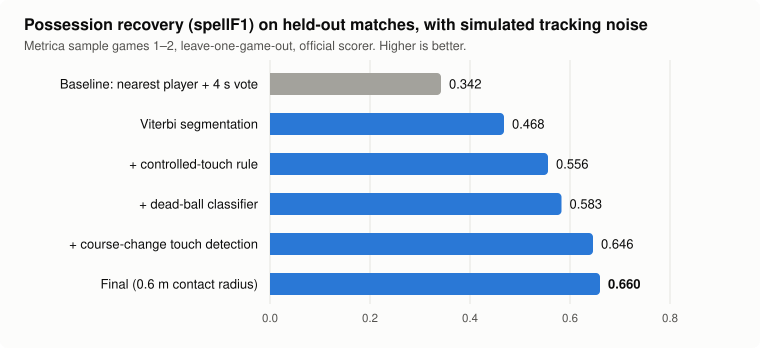
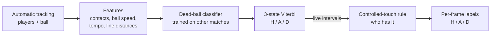

# Ball possession from automatic football tracking

This project labels every frame of a professional football match as home possession, away
possession or dead ball, using only automatic player and ball tracking. Nobody labelled the
match by hand; the model never sees the answers for the game it predicts.

I built it for More than a Hack 2027 (Metrica Sports, FC Barcelona and Mobile World Capital
Barcelona), Phase 1: Ball Possession. The data was one full LaLiga match, FC Barcelona vs
Athletic Club: 199,319 frames at 25 fps.

<p align="center">
  
</p>

| | Other matches, clean tracking | Other matches, added noise | Competition match, public 5 min |
|---|---|---|---|
| Published baseline (nearest player + vote) | 0.411 | 0.342 | 0.326 |
| My model | 0.702 | 0.660 | 0.480 |

<sub>The metric is spellF1: predicted possessions are matched one-to-one with real ones by time
overlap, and F1 is averaged over IoU thresholds from 0.3 to 0.7. The public window has only 17
possessions, so I treated it as a pipeline check, not a benchmark (more under Results).</sub>

## The problem

Each video frame gets one of three labels: `H` (home has the ball), `A` (away has it) or `D`
(ball out of play). The ranking metric counts whole possessions rather than frames. If you
split one possession in two, or start it a second late, it counts as missed. So the common
approach of classifying frames one by one and smoothing afterwards doesn't work well here.

The tracking comes straight from a computer-vision system and was never corrected. There are
no player identities, just 46 track slots tagged with a team, and they drop out and swap all
the time. The ball is missing on 41% of the frames that are scored, usually for several
seconds at a time.

## How it works



First the model decides when the ball is in play. A gradient-boosted classifier, trained only
on other matches, gives every frame a probability of being a stoppage. I kept its inputs at
team level so that tracking errors on individual players don't matter much:
- how fast the players are moving overall, at four time scales, and whether they're slowing
  down;
- how spread out they are;
- how long the ball has been missing;
- where the ball was last seen and where it reappears, relative to the touchlines and goal
  lines.

A fixed rule adds that a ball tracked outside the pitch is dead. A Viterbi decoder with switch
penalties then turns these frame scores into clean stoppage intervals.

Then, inside each live interval, it decides which team has the ball. I followed the
challenge's own definition: possession only changes when the other team gets control.
- A contact means the ball is within 0.6 m of a player.
- An opponent's contact switches possession if it lasts at least 0.4 s, or a teammate touches
  the ball next (a completed pass or reception), or it changes the ball's direction by more
  than 35° or its speed by more than 50%, which is what an interception looks like.
- Anything else keeps the previous team: a ball flying past someone, a touch that doesn't
  change its path, or no contact at all while the ball is in the air or not tracked. That
  matches the challenge's rule that loose balls stay with the team that last had them.

[docs/METHOD.md](docs/METHOD.md) has the details, including the ideas that didn't work.

## Validation

There are only five minutes of public labels for the competition match, and the rules forbid
tuning on them. So I made every design decision using other matches:

- I used Metrica Sports' public sample data, two other professional matches with event data
  annotated by people. I turned the events into frame labels with fixed rules: dead ball from
  the event before each set piece until the restart, and otherwise the team that made the last
  on-ball action.
- Everything learned was trained on one match and tested on the other, using the
  competition's own scoring code.
- I also made a noisier copy of both matches (7% of player positions removed in chunks of
  several seconds, plus jitter on the ball) to check that each improvement still held on
  messier data.
- Before relying on those matches I checked they behave like the competition match. For
  example, when the ball is missing, players move at about the same speed in both datasets
  (median 1.04 vs 1.05 m/s), so a missing ball means the same thing in each.

## Results

| Step (tested on other matches) | spellF1 clean | spellF1 noisy | macroF1 noisy |
|---|---|---|---|
| Published baseline: nearest player + 4 s majority vote | 0.411 | 0.342 | 0.712 |
| Viterbi segmentation over H / A / D | 0.498 | 0.468 | 0.763 |
| + controlled-touch possession rule | 0.574 | 0.556 | 0.777 |
| + dead-ball classifier from other matches | 0.611 | 0.583 | 0.831 |
| + course-change touch detection (0.8 m) | 0.683 | 0.646 | 0.852 |
| Final (0.6 m contact radius) | 0.702 | 0.660 | 0.851 |

On the competition match's public five minutes, scored once to check the pipeline, it gets
spellF1 0.480 and macroF1 0.690. The published baseline gets 0.326 and 0.621.

We were a team of five, and this was one of three approaches we built in
parallel. Mine scored best on the other matches. On the competition match itself, though,
a teammate's hand-tuned model was better at spotting dead balls (0.547 / 0.844 on the public
window), so that's the one we submitted. The reason is a difference between the datasets. In
the sample matches the ball is almost never tracked during a stoppage, so my classifier learned
that a visible ball means play is on. In the competition match the ball often stays tracked
through fouls and free kicks. The team's submission and technical document are in
[alessandrotavolato/mtah2027-possession](https://github.com/alessandrotavolato/mtah2027-possession).

## Repository

```
possession/               the model
  run.py                  end-to-end: tracking -> submission CSV
  model.py                evidence, Viterbi decoder, all parameters (PARAMS)
  touches.py              contact detection and the controlled-touch possession rule
  dead_model.py           dead-ball features and classifier
  features.py             ball/player features, team-shape features
  parse_atd.py, match.py  tracking parser; a match as plain arrays
  external.py             Metrica sample games -> tracking arrays + frame labels
  validate_external.py    leave-one-game-out scoring with the official metric
  tune.py                 parallel parameter search (external matches only)
  diagnostics.py          label-free sanity checks against automatic tactical tags
docs/METHOD.md            full method, ablations, dropped ideas, limitations
evaluation/, starter/, games.py   competition scorer and helpers (MIT, Metrica Sports)
```

## Running it

```bash
python3 -m venv .venv && .venv/bin/pip install -r requirements.txt
git clone --depth 1 https://github.com/metrica-sports/sample-data ~/code/external/sample-data

# Competition match. The data is licensed to participants only and isn't included here.
# Put the tactical bundle in data/tactical/ or set MTAH_DATA_DIR.
.venv/bin/python possession/run.py                     # -> evaluation/results/carl_possession.csv
.venv/bin/python evaluation/validate_submission.py evaluation/results/carl_possession.csv

# Validation on the other matches (needs only the public sample data)
.venv/bin/python possession/validate_external.py '{"final": {"dead_clf": true}}'
EXT_NOISE=1 .venv/bin/python possession/validate_external.py '{"final": {"dead_clf": true}}'
```

Results are deterministic: running it twice gives byte-identical files. Tested with Python 3.9.

## Data and licence

This repo contains no match data, tracking or per-frame output, since the competition assets
are licensed to participants only. The validation matches come from
[Metrica Sports' public sample data](https://github.com/metrica-sports/sample-data), which you
download separately.

The code in `possession/` is MIT-licensed (© 2026 Carl Weber). The scorer and helpers in
`evaluation/`, `starter/` and `games.py` are © Metrica Sports, also MIT, taken from
[metrica-sports/more-than-a-hack-2027](https://github.com/metrica-sports/more-than-a-hack-2027).
See [LICENSE](LICENSE) and [NOTICE](NOTICE).
